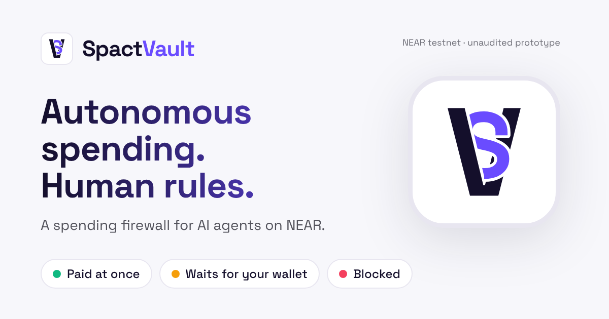

# SpactVault

*Autonomous spending. Human rules.*



SpactVault (Spact for short) is a payment-policy firewall for AI agents on NEAR. An agent asks a NEAR vault contract to pay someone. The contract enforces the owner's limits on-chain. Anything above the auto limit waits until the owner approves that exact payment from their wallet.

> **Unaudited hackathon prototype.** Local sandbox only so far. Do not use with real funds.

## Why not just give the agent a wallet

A wallet key can spend everything. A NEAR function-call key restricts which methods can be called, but its `allowance` caps gas, not dollars. SpactVault puts the rules in a contract the agent cannot change:

- **on-chain budgets:** per-payment auto limit, hard cap, and a UTC-day budget that counts in-flight transfers, so parallel requests cannot overspend
- **approval bound to exact terms:** the owner approves a hash of the stored request (recipient, amount, token, vault, network, policy version), signed with a full-access key. A backend or bot that shows different terms produces a hash the vault rejects.
- **no replay:** each request id executes at most once; the transfer callback settles exactly once
- **tests that attack it:** the Security Lab runs the bypass attempts against a real local NEAR node, and its page shows each attack with the test results behind it

## What works today

| Piece | State |
|---|---|
| Vault contract (`contracts/spact-vault`) | built, 51 unit tests |
| Real-chain tests on a NEAR sandbox node (`contracts/integration-tests`) | 10 passing: auto payment, approval flow, parallel split, failed transfer, private callback, agent bypass attempts, init front-run, pause/recovery, the agent's restricted key |
| Shared TS package: request hash, exact amounts, contract JSON schemas, reason codes, RPC client (`packages/shared`) | built, 19 tests; hash matches Rust and an independent Python vector |
| Landing page, owner dashboard and approval page (`apps/web`) | built, 30 unit tests and 16 browser tests on a local chain, including tampered RPC answers and framing |
| Hosted site | live at https://spactvault.xyz (Railway) and https://0xileri.github.io/SpactVault/ (GitHub Pages), both from main and reading the testnet vault |
| Security Lab report and page (`packages/security-lab`, `?page=security`) | built: 13 of 18 attack cases pass on a local chain, 3 in unit tests only, 2 wait for P1 |
| Agent MCP server for Claude Code / Codex (`apps/mcp`) | built, 24 unit tests and 11 tests over stdio on a local chain; run on testnet from Claude Code (paid, held for approval, blocked) |
| Local demo with no wallet or testnet needed (`scripts/dev-sandbox.sh`) | works |
| Testnet deploy script (`scripts/deploy-testnet.sh`) | ran on testnet on 2026-10-25: `vault.spact-ileri2.testnet` |
| Signing with a real wallet | done on testnet with Meteor Wallet: the owner approved and paid the 25 TUSD demo request on the hosted site. Other wallets untested |
| Telegram alert for the owner (`apps/notifier`) | built, 27 unit tests and 4 tests on a local chain against a mock Bot API; not yet tried with real Telegram |
| NEAR Intents / 1Click cross-chain route | not yet (P1) |

Details: [docs/STATUS.md](docs/STATUS.md). Security mapping: [docs/THREAT_MODEL.md](docs/THREAT_MODEL.md).

## Let Claude Code or Codex pay

`apps/mcp` is an MCP server with two tools, `request_payment` and `get_payment_status`. It signs with the agent's function-call key and refuses to start with a full-access key. `scripts/dev-sandbox.sh` prints the `claude mcp add` and `codex mcp add` commands for the local chain. Then ask the agent to pay `api.test.near` 5 TUSD (paid at once) or 20 TUSD (it gets an approval link and waits for you). Setup for testnet: [apps/mcp/README.md](apps/mcp/README.md). On testnet, Claude Code paid 5 TUSD at once, waited for the owner on 12 TUSD, and was blocked paying `evil.testnet` (docs/STATUS.md).

## Security Lab

```bash
scripts/security-report.sh
```

This runs every suite, then builds `apps/web/public/security-report.json` from the runners' own output. Open `http://localhost:5173/?page=security` while `scripts/dev-sandbox.sh` is running. Each attack from AGENTS.md section 10 is listed with the exact tests behind it, their results and where they ran. The page also shows the commit, the run, and a sha256 of each raw output file. A case passes on a local chain only if every listed test passed and at least one ran against a NEAR node. The page recomputes that itself instead of trusting the file. In CI the same report is the `security-report` artifact of each run.

## Live on testnet

**Testnet only. TUSD is a test token with no value. Unaudited prototype.**

| | |
|---|---|
| Site (overview, approvals, Security Lab) | https://spactvault.xyz (also https://0xileri.github.io/SpactVault/) |
| Vault | [`vault.spact-ileri2.testnet`](https://testnet.nearblocks.io/address/vault.spact-ileri2.testnet), code hash `bb664f2a1b19734e5bbb8f01372d737fcc724ae008be284603c7dd4dc191c81c` |
| Owner (approves in Meteor Wallet) | [`0xileri.testnet`](https://testnet.nearblocks.io/address/0xileri.testnet) |
| Agent (function-call key for two vault methods only) | [`agent.spact-ileri2.testnet`](https://testnet.nearblocks.io/address/agent.spact-ileri2.testnet) |
| Test token / payee | [`tusd.spact-ileri2.testnet`](https://testnet.nearblocks.io/address/tusd.spact-ileri2.testnet) / [`api.spact-ileri2.testnet`](https://testnet.nearblocks.io/address/api.spact-ileri2.testnet) |

The deploy script made two agent requests: 3 TUSD, paid automatically, and 25 TUSD, which the owner approved and paid from the site with Meteor Wallet. The code hash is from the owner's build; a build on another machine gives a different hash for now (docs/STATUS.md).

## Hosted site

After every job passes on main, CI publishes the site to GitHub Pages at https://0xileri.github.io/SpactVault/, with the Security Lab report from that same run. `/` is a landing page that states the vault's limits as read from its policy and shows live numbers from chain; the owner dashboard is `?page=overview`, the Security Lab `?page=security`, Privacy and terms `?page=legal`, and approval links stay `?request=<id>`. Nobody uploads the report by hand. A build without a vault id is the Security Lab alone; the overview and approval links then say that no vault is connected.

Repository settings this needs: Settings → Pages → Source **GitHub Actions** (once), and the repository variable `VITE_VAULT_ID` (Settings → Secrets and variables → Actions → Variables) set to the vault id, now `vault.spact-ileri2.testnet`. After changing it, re-run the workflow on main. `VITE_NEAR_NETWORK` defaults to `testnet` and `VITE_NEAR_RPC_URL` to `https://test.rpc.fastnear.com`. These are public values, not secrets.

## Deploy to Railway

The root `Dockerfile` builds the site and serves it with Caddy, which sends security headers that GitHub Pages cannot, such as `X-Frame-Options: DENY` (DECISIONS ADR-025). CI builds and checks the same image on every push (`web-image` job).

1. At https://railway.com create a project from the GitHub repo. If Railway offers one service per package, keep a single service at the repository root. Its build log says `Using detected Dockerfile!`.
2. Under the service's **Variables**, set `VITE_VAULT_ID=vault.spact-ileri2.testnet`. The other settings have defaults in the `Dockerfile`: testnet, `https://test.rpc.fastnear.com`, the Security Lab report from the GitHub Pages site, and this repository's link.
3. Under **Settings → Networking**, generate a domain or add your own; this project uses `spactvault.xyz`. The share card uses the generated domain automatically (`RAILWAY_PUBLIC_DOMAIN`). For a custom domain, also set `VITE_SITE_URL=https://<your domain>`.
4. Under **Settings**, turn on **Wait for CI**, so Railway deploys a commit only after GitHub Actions passed on it.
5. When it is up, check it: `scripts/check-web-image.sh https://<domain> https://<domain>`.

Cost: Railway's trial is a one-time $5 for 30 days. After that the Free plan includes $1 a month, or Hobby is $5 a month.

## Get a Telegram alert

`apps/notifier` messages you when a payment waits for your approval: the exact terms plus a link to the approval page. It messages again when the payment is paid. The bot can't approve anything; your wallet does. Link your chat once with a code the notifier prints on its terminal. Setup: [apps/notifier/README.md](apps/notifier/README.md).

## Try the approval flow locally

No wallet, testnet or funds needed. One command starts a local NEAR chain with a funded vault, a local signer holding the sandbox owner key, and the approval page.

```bash
pnpm install --frozen-lockfile
scripts/dev-sandbox.sh
```

1. Wait for `Open http://localhost:5173/?request=demo-approve-1` and open it. You see **25 TUSD to api.test.near**, status **Awaiting approval**, the agent's note, the policy (auto up to 10 TUSD, at most 30 TUSD per payment, **47 TUSD of 50** left today), and a green **Hash check passed** box.
2. Click **Connect Local sandbox signer**. The header shows `owner.test.near`.
3. Click **Approve and pay**. You see **Confirmed on chain: approved and paid** with a transaction hash, the status turns **Paid**, and the budget drops to **22 TUSD of 50**.
4. Open http://localhost:5173/?page=overview, the dashboard. The demo request is gone from **Waiting for your decision**, it shows as **Paid** under **Agent activity**, and the TUSD card shows **22 TUSD of 50 TUSD left today** and **Vault holds 972 TUSD**.

To watch the attacks fail, run `pnpm e2e`. It drives Chromium against the same local setup, and you see `16 passed`. Three of those tests rewrite the RPC response on its way to the page:

- **Recipient changed, hash kept:** the page shows **Hash check failed: do not approve** and the approve button is disabled.
- **Recipient and hash both forged:** the page shows the attacker's terms with a passing check, the owner approves, and the vault refuses with `HASH_MISMATCH`. The test then reads the chain directly: nothing moved and the request still awaits approval.
- **Budget inflated:** the dashboard sees that the numbers don't add up and shows **Budget numbers from the RPC do not add up** instead of them.

## Deploy to testnet

`scripts/deploy-testnet.sh` uses only commands from the NEAR docs. It ran on testnet on 2026-10-25 (from WSL Ubuntu on Windows) and is rehearsed end to end against a local node (`scripts/rehearse-deploy-sandbox.sh`). It needs bash, so on Windows run it in WSL.

1. Install rustup, a C toolchain (`sudo apt install build-essential` on Ubuntu), Node 22.12+ and near-cli-rs: `npm install -g near-cli-rs@latest` (other options: https://docs.near.org/tools/cli#installation).
2. Create the **owner** account in a wallet. Pick a `.testnet` account; this is the account that approves payments. Meteor Wallet works (https://wallet.meteorwallet.app, switched to testnet). It needs a little testnet NEAR for gas: `near tokens <name>.testnet send-near <owner>.testnet 1NEAR network-config testnet sign-with-legacy-keychain send` after step 3.
3. Create a **deployer** account. Its key lands in `~/.near-credentials`:
   `near account create-account sponsor-by-faucet-service <name>.testnet autogenerate-new-keypair save-to-legacy-keychain network-config testnet create`
   The script spends about 6.6 testnet NEAR. Contract code alone locks about 4.3 NEAR, at roughly 1 NEAR per 100 KB. Top up from https://docs.near.org/getting-started/faucet if needed.
4. Run `scripts/deploy-testnet.sh <name>.testnet <owner>.testnet`. You see `protocol version N` (it refuses below 84). It stops before building or spending anything if the owner account does not exist, or if this deployer was used before. Then you see one confirmation per step. It ends with the vault id, its code hash, the agent's key files, and three `VITE_` lines. The agent's two demo requests are signed with a function-call key that can call only `request_direct_payment` and `execute_request` on the vault. That key goes in `~/.near-credentials/spact/agent.<name>.testnet.json`. The agent account's full-access key stays in your keychain; don't give it to the agent.
5. Set the repository variable `VITE_VAULT_ID` (see "Hosted site") and re-run the workflow, or put those lines in `apps/web/.env.local` and run `pnpm --filter @spact/web dev`. Open `?request=demo-approve-1` on the site (locally `http://localhost:5173/?request=demo-approve-1`) and connect the owner wallet within 24 hours, before the request expires. Click **Approve and pay** and confirm in the wallet. You see **Confirmed on chain: approved and paid**, with a link to testnet.nearblocks.io.

## Deploy to mainnet

`scripts/deploy-mainnet.sh` deploys a vault that spends real USDC within small fixed limits, then locks its code (DECISIONS ADR-028). It is rehearsed end to end against a local node with a stand-in USDC (`scripts/rehearse-mainnet-sandbox.sh`). Nothing here has run on mainnet yet. It spends real funds, so you run it yourself, on your own machine, and it waits for you to type `deploy to mainnet`.

1. Do steps 1 and 2 of "Deploy to testnet" (tools, an owner wallet), with a mainnet owner account such as `alice.near`.
2. Create a named mainnet **deployer** account in a wallet, e.g. `yourname.near`. Fund it with about 3.5 NEAR plus 5 USDC. It must be native USDC, not the bridged USDC.e. Then import it into near-cli on your machine; near-cli asks for the seed phrase itself:
   `near account import-account using-seed-phrase network-config mainnet`
3. Run `scripts/deploy-mainnet.sh <deployer>.near <owner>.near`. Before spending anything, it checks:
   - the chain and protocol version;
   - the accounts;
   - that the token says USDC with 6 decimals;
   - your NEAR and USDC balances.

   Then it prints what it will spend and the most you can lose. Compare the token id it prints with Circle's list (https://developers.circle.com/stablecoins/usdc-contract-addresses) before you type `deploy to mainnet`.
4. It creates `vault.`, `agent.` and `api.<deployer>`, deploys the vault with these limits: paid at once up to 1 USDC, waits for the owner up to 3, 5 a day, only to `api.<deployer>`. It gives the agent its restricted key, registers USDC storage and moves the 5 USDC float into the vault. Then it deletes the vault's full-access key and checks that none is left. From then on nobody can change the vault's code, and only the owner can take the USDC out (`owner_withdraw`).
5. Point the sites at it with `VITE_NEAR_NETWORK=mainnet`, `VITE_NEAR_RPC_URL` and `VITE_VAULT_ID`: as Railway service variables, and as repository variables for GitHub Pages. The MCP server needs `SPACT_NETWORK=mainnet` and `ENABLE_MAINNET_TRANSFERS=true`.

## Run the tests

Prerequisites: rustup (run `rustup toolchain install` inside `contracts/` to get the pinned 1.97.0 toolchain and wasm target), Node 22.12+, pnpm 10, and a C compiler (only used in containers with a low open-file limit).

```bash
# contracts: build wasm, unit tests, then sandbox tests on a local NEAR node
scripts/test-contracts.sh

# TypeScript
pnpm install --frozen-lockfile
pnpm lint && pnpm typecheck && pnpm test && pnpm build
```

Expected: `51 passed` (vault unit), `1 passed` (mock token), `10 passed` (sandbox), `19 passed` (shared), `30 passed` (web), `24 passed` (mcp), `27 passed` (notifier) and `8 passed` (security-lab). `pnpm mcp:sandbox` runs the MCP server over stdio against a local chain: `11 passed`. `pnpm notifier:sandbox` runs the notifier against a local chain and a mock Bot API: `4 passed`. The first sandbox run downloads the NEAR sandbox node binary.

On testnet or mainnet the page uses a real wallet through near-connect. Configure it with `apps/web/.env.example`.

## NEAR technology used

- **NEAR smart contract** (Rust, near-sdk 5.29.1): policy, budgets, approvals, the request state machine
- **NEP-141** fungible tokens: the vault pays with `ft_transfer` and checks the result in a private callback
- **Access keys:** owner actions require 1 yoctoNEAR, which function-call keys cannot attach, so only a full-access (wallet) signature can approve or change policy. The protocol rejects the attempt with `DepositWithFunctionCall`, as a sandbox test shows.
- **Function-call access keys:** the agent signs with a key that can call only the vault's `request_direct_payment` and `execute_request`. A leaked agent key cannot move NEAR, add keys or call anything else; sandbox tests show each protocol rejection.
- **NEP-297 events** for every state change
- **NEAR Connect** (`@hot-labs/near-connect`) for owner wallets on testnet and mainnet, with each wallet's code in a sandboxed iframe
- **NEAR JSON-RPC**: the approval page reads the vault directly, with no backend in between
- **MCP** (`@modelcontextprotocol/server`): the agent's tools, backed by its function-call key

NEAR Intents is planned for a human-approved cross-chain payout (P1) and is not integrated yet.

## Repo map

```text
AGENTS.md                 canonical product + security spec (read first)
contracts/                Rust workspace: vault, mock token, sandbox tests
apps/web/                 owner approval page, dev signer, browser tests
apps/mcp/                 the agent's MCP server (stdio) and its sandbox tests
apps/notifier/            Telegram alerts for the owner, with a mock Bot API for tests
packages/shared/          TS types, request digest, amount helpers, JSON schemas, RPC client
packages/security-lab/    builds the Security Lab report from test output; catalog of attacks
scripts/                  build and test scripts
docs/                     architecture, threat model, decisions, status, integrations
```
